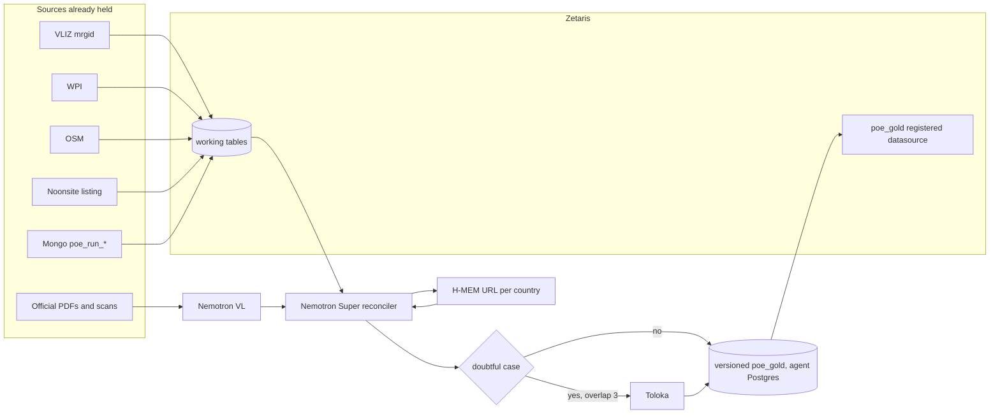

# GenAI.works hackathon plan — Blue Intelligence (PoE Reconciler agent)

The mono-repo split is a separate document: [PLAN_SEPARATION_DEPOTS.md](PLAN_SEPARATION_DEPOTS.md). The Nebius × NVIDIA plan, for NAVIGUIDE, is in [PLAN_HACKATHON_NEBIUS_NAVIGUIDE.md](PLAN_HACKATHON_NEBIUS_NAVIGUIDE.md).

Plan date: 16 October 2026, updated 17 October 2026 (see “Decisions of 17 October 2026” at the end). Build window: **22 October 2026 00:00 UTC → 27 October 2026 23:45 UTC** (Open Agent Hackathon 2026, GenAI.Works).

Every line of code already in the repository is **pre-existing**. Only work committed after 22 October 2026 00:00 UTC counts toward the score. This file is a plan, not that work.

Target product: a **PoE Reconciler** agent. For an exclusive economic zone identified by its VLIZ `mrgid`, it crosses the sources already held, has Nemotron VL read the official PDFs, reconciles the lists with Nemotron Super while citing its evidence, keeps the productive URLs per country (Meterless H-MEM, reimplemented in Python), sends doubtful cases to human reviewers (Toloka, overlap of 3), and writes a versioned `poe_gold` table into the agent’s own Postgres, registered in Zetaris and read back through Zetaris (§4.3).

Required hackathon stack (rule 05, every track): **Zetaris** and **Meterless** integrated, built with **Cursor**. Models: NVIDIA Nemotron (VL + Super). Meterless has **no API, no key, and no credit** (confirmed by Pavlo on the forum, 13 October 2026): its engines are implementation specifications, and Blue Intelligence reimplements the H-MEM contract in Python (§6.5). Markovian and World Model stay optional. Human validation: Toloka account already credited, handled by Clément.

Target track: **01 — Solving Fragmented Intelligence**. The full demo stays ports of entry. Harbour masters are a proof of concept. Marinas and marine protected areas stay at design stage. Climatology is out of scope.

Business contract: `docs/CAHIER_DES_CHARGES_POE.md`, in particular §6.3 (the Top-Down and Bottom-Up arms write the same `mrgid` sheet; a catalogue page is read in full). That paragraph is described as unimplemented in the current code (`judge_one` answers for a single name).

---

## 1. Pre-existing inventory

Text that can be reused as-is in the “Pre-existing components” section of the submission. Everything below exists as of 16 October 2026. The module `backend/app/agent_poe/` does not exist. The Mongo collection `review_gold` exists and holds **0** documents. There is no `poe_gold` table.

The repository `Berry-Mappemonde/Blue-Intelligence-Map` (1,249 commits) mixes Blue Intelligence (`backend/`, `frontend/`, product `infra/`, PoE `docs/`) and NAVIGUIDE (`naviguide/`, `naviguide-simulator/`). The agent does not depend on the simulator.

### 1.1 Shared core — `backend/app/core/`

| File | Role already in place |
|---|---|
| `nvidia.py` | NVIDIA NIM client (`https://integrate.api.nvidia.com/v1/chat/completions`). Chains `judge` / `extract` / `legal` / `json` / `page` / `text` / `review`. `chat_payload(..., images=)` already builds a text + JPEG message. `complete_json_nvidia_tracked` accepts images. Default models on these chains are gpt-oss, Muse, Kimi, Flash: **not** Nemotron. |
| `vision_msg.py` | `openai_user_content(text, images)` and `claude_user_content`: JPEG as base64, OpenAI or Anthropic format. |
| `extract.py` | URL reading (HTTP, PyMuPDF PDF out of process, Chromium render). `pdf_page_jpegs` renders the first pages as JPEG. `looks_like_port_catalog`, `extract_structured_ports`, `catalog_is_sufficient` already recognise the France, Mexico, New Zealand, United Kingdom, Egypt, Albania, and Sint Maarten catalogues. SHA-256 text cache planned in `backend/data/cached_pdfs/` (directory absent on this machine, ignored by git). |
| `judge.py` | `ask_yes_no`: one name, a yes / no / insufficient verdict, one URL from a closed list. This is the residual judge, not the §6.3 list extractor. |
| `llm.py` | JSON facade: NVIDIA, then OpenRouter, then Claude. `extract_ports`, `ask_json`. Web search stays on OpenRouter. |
| `claude.py` | Second Anthropic reader (Haiku), budget, prefix cache. Outside the required hackathon stack. |
| `dedup.py` | `normalize_name`, merge of sheets under 500 m or by name similarity. |
| `geo.py` | Nominatim ∥ GeoNames geocoding, point-in-VLIZ-polygon, river / land exceptions. |
| `pdf_worker.py` | PyMuPDF subprocess: text of a PDF; a native crash does not kill the API. |
| `pdf_preview.py` | Subprocess: first pages of a PDF as JPEG (quality 70, max width 1280). |
| `rag.py` | Local chunking and passage selection before the model call. |
| `search.py` | Named search (TinyFish, SERP filter, DuckDuckGo with no key). |
| `tinyfish.py` | Search, Fetch, anti-bot agent. Capped credit. Outside the required stack. |
| `serper.py` | Google SERP, organic results only. |
| `ml.py` | URL classifier and NER trained on the existing stock. |
| `events.py` | Structured log `poe_run_events` (run, mrgid, step, payload). |
| `render.py` / `render_worker.py` | Chromium out of process for JavaScript pages. |
| `identity.py` | “Same place” versus “same code”. |
| `nav_rule.py` | Heuristic: is this sentence a navigation rule? |
| `run_rules.py` | Numeric thresholds (catalogue, coast, zoom), read from `backend/data/run_rules.json`. |
| `export_meta.py` | SHA-256 fingerprint of GeoJSON exports. |
| `from_scratch.py` | A Full run rebuilds; a Test stays incremental. |
| `enrich.py` | Marina / harbour-master enrichment chain (`run_page_enrich`). |
| `tasks.py` | Background task state. |
| `seamark_catalog.py` | Read of the OSM seamark catalogue. |
| `project_geo.py` | Rules for publishing a scientific project site. |

### 1.2 PoE pipeline — `backend/app/services/poe_*.py` and neighbours

| File | Role already in place |
|---|---|
| `poe_pipeline.py` | Top-Down arm: VLIZ polygon → state domains → search → download → extraction → geocoding → write under the `mrgid`. `generate_zone_poe` orchestrates one zone. Public “generate” routes return 410: the UI no longer rewrites `poe_ports`. |
| `poe_runs.py` | Versioned runs `poe_run_zones`, `poe_run_ports`, `poe_run_events`. Resume, 900 s per zone. Does not write `poe_ports`. |
| `poe_seeds.py` | Bottom-up union without crawl: v1 map + runs + Noonsite listing + OSM + WPI counter-list. Verdicts `confirmed` / `probable` / `unverified` / `name_only`. |
| `poe_seed_enrich.py` | Geocodes names that have no GPS, judges the others. The §6.3 gap is here: the page opened for one name is not yet re-read as a catalogue. |
| `poe_zone_fiche.py` | Read-only sheet for one polygon: Top-Down URL, ports, Bottom-Up URL. |
| `poe_zone_label.py` | One VLIZ polygon = one sheet. Mainland France is not Mayotte. |
| `poe_stable.py` | Eleven `mrgid` values whose source discovery is treated as stable (France 5677, Mayotte 48944, New Caledonia 8312, Mexico 8429, Niue 8447, United Kingdom 5696, and others). |
| `poe_confidence.py` | Score 0–100: source, reading, map, cross-checks. This is not an official truth. |
| `poe_diff.py` | Port-by-port comparison between the v1 map and a run. |
| `poe_bestof.py` | Synthesis across runs, written into a new run, never into `poe_ports`. |
| `poe_report.py` | Numeric report from the run’s events and ports. |
| `poe_gps_registry.py` | Git registry of arbitrated GPS points (`docs/data/poe-gps-arbitrated.json`). |
| `poe_confirmed_gps_audit.py` | Audit of “confirmed” GPS (homonyms, river). |
| `poe_name_only_review.py` | Applies the manual review of the 33 names without coordinates. Does not write `poe_ports`. |
| `wpi_ports.py` | Commercial counter-list, NGA Pub 150. `match_wpi_port` at ≤ 1 km. The WPI “First Port of Entry” field is not evidence of pleasure-craft clearance. |
| `osm_seeds.py` | OSM seeds (control, customs, marina within 800 m of a control) attached to an `mrgid`. |
| `osm_validate.py` | OSM score around an already known port, without changing the name or the GPS. |
| `listing_ref.py` | Projection of the community listing (Noonsite) onto an `mrgid`. The listing is not an official source. |
| `listing_control.py` | Gap between listing and run, review queue, without annotating the ports. |
| `territory_ref.py` | Official URLs from `territories.json` attached to a polygon. |
| `review_extract.py` | Extraction from documents already judged Gold. Does not write `poe_ports`. |
| `review_doc_picker.py` | Formalities document judge: full page or PDF JPEG to the vision model when the backend supports it. |
| `review_gold.py` | Gold switch of the human review. Writes `review_gold` only. 0 documents at the time of this plan. |
| `review_queue.py` / `review_choices.py` / `review_suggest.py` / `review_lessons.py` | Human queue, one card at a time, keep/discard choices, lessons for the next batch. |
| `zee_crossings.py` | Intersection of the Berry-Mappemonde route with Marine Regions polygons. |

### 1.3 Other modes already coded (reused in §11, not rebuilt)

| File | Role already in place |
|---|---|
| `services/capitainerie_world.py` | Worldwide dump of OSM `harbour_master` offices, plus SHOM and NOAA. Phone and VHF already parsed. |
| `services/capitainerie_enrich.py` | Harbour-master enrichment: tags, official page, regex, then a model. |
| `services/marina_world.py` | OSM dump `leisure=marina`. Identity = `osm_id`. Capacity, draught, and service tags. |
| `services/marina_build.py` / `marina_enrich.py` | Corridor build and single-marina enrichment. |
| `services/amp.py` | ProtectedSeas marine protected areas. Polygons by extent, ArcGIS fields (`site_id`, `purpose`, `entry`, `speed`, `url`). |
| `services/amp_visit.py` | Search for a visit URL distinct from the manager URL. |
| `routers/formalities.py` | Formalities API, sheet `GET /api/poe/zones/{mrgid}`. |
| `routers/runs.py` | Versioned-run API. |
| `routers/capitaineries.py` | Harbour-master API. |
| `routers/marinas.py` | Marina and anchorage API. |
| `routers/amp.py` | MPA API. The reference regulation text stays ProtectedSeas. |
| `routers/review.py` | Existing human-review API. |
| `config.py` / `db.py` / `main.py` | Paths, backend `.env`, Mongo client, FastAPI application. |

The other services (scientific projects, wind / wave / current / cyclone climatology, discovery swarm) exist and stay outside the agent. Climatology is not in the hackathon.

### 1.4 Interface — `frontend/`

React application (Create React App) of the Blue Intelligence map, separate from `naviguide-simulator/`.

| File | Role already in place |
|---|---|
| `src/App.js` | Shell: Formalities, Marinas, Harbour masters, MPA, Science, Climatology, Projects, Review. |
| `src/api.js` | HTTP client to the backend. |
| `src/i18n.js` | FR/EN labels. |
| `src/components/MapView.js` | Map and popups. |
| `src/components/MapLayersSidebar.js` | Layer switches. |
| `src/components/FormalitiesPanel.js` | Ports-of-entry panel. |
| `src/components/ZoneFiche.js` | Zone sheet. |
| `src/components/review/PoeFiche.js` | PoE review sheet. |
| `src/components/MarinasPanel.js` / `review/MarinaFiche.js` / `audit/MarinasCard.js` | Marinas. |
| `src/components/CapitaineriesPanel.js` / `review/CapitainerieFiche.js` / `audit/CapitaineriesCard.js` | Harbour masters. |
| `src/components/AmpPanel.js` / `review/AmpFiche.js` / `audit/AmpCard.js` | MPAs. |
| `src/components/map/useFormalitiesLayers.js` | PoE layer. |
| `src/components/map/useMarinasLayer.js` | Marina layer. |
| `src/components/map/useCapitaineriesLayer.js` | Harbour-master layer. |
| `src/components/map/useAmpLayer.js` | MPA layer. |
| `src/components/ReviewView.js` | Review screen, one card at a time. |
| `src/components/audit/RunsPanel.js` / `RunJournal.js` | Run journal. |
| `src/components/AgentConsole.js` | Operator console. |

The other files under `frontend/src/components/` (science, climatology, projects, legend, isobaths, basemaps) are pre-existing and are not modified for the PoE demo.

### 1.5 Embedded data — `backend/data/`

| File | Contents |
|---|---|
| `eez_world_map.geojson` | Simplified VLIZ v12 polygons. Properties: `mrgid`, `name`, `geoname`, `iso2`, `sovereign`, `pol_type`. About 18 MB. Licence: `LICENSE_EEZ_v12.txt`. |
| `eez_french.geojson` | French extract. |
| `listing_control/all_countries.json` | Community listing harvested on 2026-09-05: 196 countries, **1,193** ports of entry, **1,092** other ports. Roles `poe` / `other`. This is not a Gold. |
| `listing_control/eez_index.json` / `slug_overrides.json` | Join from listing slug to `mrgid`. |
| `wpi_ports.json` | NGA snapshot: **3,805** ports. Actual columns: `index`, `name`, `lat`, `lon`, `country` (English name, e.g. `France` = 66, `Mexico` = 35, `United Kingdom` = 186, `New Caledonia` = 3, `Niue` = 1), `harbor_use`. **No UN/LOCODE column** in this snapshot. |
| `osm_port_priors.json` | **967** OSM objects within 800 m, already attached to one or more `mrgid` values (`eez[]`). Fields: `id`, `name`, `lat`, `lon`, `kinds`, `customs`, `border_control`, `port_of_entry`. |
| `poe_exceptions.json` | Remembered state domains (`manual`) and productive URLs per country code (`seed_urls`), including the France, Mexico, Niue, and Venezuela PDFs. This is the current URL memory, not yet H-MEM. |
| `territories.json` | France / overseas reference and blocklist (Noonsite, forums, Wikipedia). |
| `curated_marinas.json` | 22 marinas on the Berry-Mappemonde route, with capacity and VHF when known. |
| `official_homes_search.jsonl` / `official_listings_search.jsonl` | Search logs of homepages and official directories. |
| `run_rules.json` | Pipeline thresholds. |
| `compound_splits.json` / `home_reviews.json` / `master_seeds.json` | Scientific projects, another mode. |
| `seamark_catalog.json` | Seamarks. |
| `route.geojson` | Official Berry-Mappemonde route. |
| `climatology/` | Monthly atlases of wind, waves, current, cyclones. Outside the hackathon. |
| `cached_pdfs/` | Planned by `extract.py`, **absent from disk** on 16 October 2026. Official PDFs are known by URL, not by a local file. |

### 1.6 What the submission says in one sentence

The PoE pipeline, the catalogue parsers, JPEG vision, Mongo runs, the listing, WPI, OSM, and the review sheets exist. §6.3 (read the whole list, with a page proof), cited multi-source reconciliation, H-MEM of URLs, the Toloka send, the H-MEM conformance adapter, and the `poe_gold` table (agent Postgres registered in Zetaris) are the new work, after 22 October 2026 00:00 UTC.

---

## 2. Repository split

After his current batch of work (target: before 22 October 2026 00:00 UTC), Clément splits `Blue-Intelligence-Map` into two repositories (Blue Intelligence and NAVIGUIDE) himself and points the VPS at them. Only Blue Intelligence is presented at this hackathon. Commands, risks, and the eight tests that allow archiving are in [PLAN_SEPARATION_DEPOTS.md](PLAN_SEPARATION_DEPOTS.md).

This plan starts once that split is done. On 22 October 2026 at 00:00 UTC, graded code lives in the Blue Intelligence repository, already in production. The only new package is `backend/app/agent_poe/`. The repository README separates pre-existing and new. No agent code before 22 October 2026 00:00 UTC.

## 3. Target architecture

One chain, one configuration per tab (§11). The demo runs this chain for ports of entry.



`poe_gold` is written by the agent into its own Postgres (Method A, §4.3), then registered in Zetaris and read back and joined there with the other sources.

### 3.1 New module — `backend/app/agent_poe/`

None of these files exist today. They call the code in §1; they do not copy it.

| File | Planned signature | Existing code called |
|---|---|---|
| `config.py` | `TabConfig`: `tab`, `sources`, `vl_schema`, `reconcile_rules`, `toloka_question`, `gold_table`. `CONFIGS["poe"]` is the demo. | `poe_stable.STABLE_REVIEW_MRGIDS` for the demo set. |
| `zetaris_client.py` | `run_sql(sql: str, *, source: str = "SqlEditor", limit: int = 1, query_id: str \| None = None) -> dict` — **SELECT-only** (plus, on 22 Oct only, the one-off `CREATE DATASOURCE` / `REGISTER DATASOURCE TABLES` setup and the Method B test, run by a separate setup script, not by this client) | None. HTTP only: `POST {ZETARIS_REST_URL}/sql-editor/sqls/run`, headers `Authorization: Bearer`, `X-Org-ID`, `X-Request-ID`. Body confirmed on 16 Oct: `queryId` (UUID), `sql`, `source` = `"SqlEditor"`, `limit`. |
| `load_sources.py` | `load_zone(mrgid: int) -> ZoneBundle` | `territory_ref`, `listing_ref.project_listing`, `wpi_ports.match_wpi_port`, OSM via `osm_port_priors.json` / `osm_seeds`, Mongo reads of `poe_ports`, `poe_run_ports`, `poe_seed_ports`, `eez_zones`. Writes: **working** CSV/Parquet files, then an ingest `run_sql`. Never a write to `poe_ports`. |
| `vl_extractor.py` | `extract_document(url: str, content: bytes, *, schema: dict, max_pages: int = 4) -> VlResult` | `extract.pdf_page_jpegs` or `pdf_preview`, `vision_msg.openai_user_content`, `nvidia.chat_payload` with model `nvidia/nemotron-3.5-super-vl-120b-a12b`, `reasoning_effort="none"`. Check: `extract.looks_like_port_catalog` and `extract_structured_ports` on `pdf_worker` text if VL returns an empty list. |
| `reconciler.py` | `reconcile(zone: ZoneBundle, documents: list[VlResult]) -> list[Verdict]` | `dedup.normalize_name`, `geo.classify_poe_point` to attach a French name to the right polygon, `nvidia.complete_json_nvidia_tracked` forced onto `nvidia/nemotron-3-super-120b-a12b` (not the gpt-oss chain). `ask_yes_no` serves only the residue that has no page. |
| `memory.py` | `remember(country_iso2: str, url: str, evidence: Evidence) -> None` and `recall(country_iso2: str) -> list[Memory]` | H-MEM contract rewritten in Python (no Node at runtime), with Nemotron as the model for mining. Seeded from `poe_exceptions.json` → `seed_urls`. Working layer, then long_term. Cited as Meterless H-MEM in the README and `metadata.json`. |
| `hmem_adapter/index.ts` (outside the Python runtime) | Exports `class HMEM`, delegating to the Python `memory.py` (subprocess or local HTTP). | Lets the official Meterless conformance suite run on our implementation: `HMEM_IMPL=/abs/path/index.ts npx tsx conformance/runner.ts`. Green scorecard = definition of done. |
| `toloka_task.py` | `build_tasks(verdicts: list[Verdict], *, overlap: int = 3, limit: int = 30) -> list[Task]` and `aggregate(answers: list[Answer]) -> list[Verdict]` | Classic Toloka API. Each task carries the original excerpt and its English translation. Cap of 30, configurable. `review_queue` is not wired to it. |
| `gold.py` | `publish(mrgid: int, rows: list[Verdict], *, parent_version: str \| None) -> str` | Inspired by the versioning of `review_gold.gold_key` and by `export_meta` (fingerprint). **Writes (INSERT only) into the agent’s own Postgres** (`POE_GOLD_PG_URL`, Method A, §4.3), never through `zetaris_client`. That Postgres is registered in Zetaris, so the table is read and joined through Zetaris. Does not write `poe_ports` or `review_gold`. |
| `run.py` | `run_mrgid(mrgid: int, tab: str = "poe") -> GoldVersion` | Chains the functions above. One `mrgid` at a time, as in the brief. |

`ZoneBundle`, `VlResult`, `Verdict`, `Evidence`, and `Task` are dataclasses of the package. Their JSON is in §5.

### 3.2 Nemotron call rule

On the trial, VL spent the 1,000 output tokens on reasoning and returned empty content. The same call with `reasoning_effort: "none"` and `chat_template_kwargs.enable_thinking: false` returned JSON in 67 tokens. **Every VL and Super call of the agent sets `reasoning_effort` to `none`**, and keeps `max_tokens` high enough for the JSON (1,500 for one page, more if the document has several pages). Demo Super can stay at 1,000: the text trial answered in 53 tokens.

Exact VL model: `nvidia/nemotron-3.5-super-vl-120b-a12b`.
Exact Super model, already in `.env` as `NEMOTRON_MODEL`: `nvidia/nemotron-3-super-120b-a12b`.
Base: `MODEL_BASE_URL` = `https://integrate.api.nvidia.com/v1`.

---

## 4. Zetaris schema

Demo format: **CSV** (one file per table, inspectable in the Zetaris UI on port 3000). Polygons are not Parquet: the `geometry_wkt` column carries the outline as WKT text, limited to the demo zones so it stays light. The world GeoJSON stays in `backend/data/` and is not reloaded in full.

Every query uses the body confirmed in §6.1: `source` is literally `"SqlEditor"`, plus `queryId`, `sql`, and `limit`. That string is not a table name.

Join keys, in order:

1. `mrgid` (VLIZ integer) — key of the sheet. Never the country alone: France has several polygons.
2. `locode` when the document or a source provides it. The current WPI snapshot has none: do not invent it.
3. `name_norm` = `dedup.normalize_name` (lowercase, no accents, no “port de”).
4. Otherwise, distance ≤ 1 km between two points that are already geocoded (`wpi_ports.WPI_PROXIMITY_KM`).

### 4.1 Tables

`eez` — one row per demo polygon.

| Column | Type |
|---|---|
| `mrgid` | INT, key |
| `name` | STRING |
| `geoname` | STRING |
| `iso2` | STRING |
| `sovereign_iso2` | STRING |
| `geometry_wkt` | STRING |

`wpi_ports` — commercial counter-list, not evidence of pleasure craft.

| Column | Type |
|---|---|
| `wpi_index` | STRING, key |
| `name` | STRING |
| `name_norm` | STRING |
| `lat` | DOUBLE |
| `lon` | DOUBLE |
| `country_name` | STRING |
| `harbor_use` | STRING |

`osm_ports` — priors already attached.

| Column | Type |
|---|---|
| `osm_id` | STRING, key |
| `name` | STRING |
| `name_norm` | STRING |
| `lat` | DOUBLE |
| `lon` | DOUBLE |
| `customs` | BOOLEAN |
| `border_control` | BOOLEAN |
| `port_of_entry` | BOOLEAN |
| `mrgid` | INT |

`noonsite_poe` — control listing. `role` = `poe` or `other`.

| Column | Type |
|---|---|
| `slug` | STRING |
| `country_name` | STRING |
| `mrgid` | INT |
| `name` | STRING |
| `name_norm` | STRING |
| `role` | STRING |

`poe_runs` — read-only export of Mongo runs already paid for. Not a continuous copy.

| Column | Type |
|---|---|
| `run_id` | STRING |
| `mrgid` | INT |
| `name` | STRING |
| `name_norm` | STRING |
| `lat` | DOUBLE |
| `lon` | DOUBLE |
| `source_url` | STRING |

`docs_cache` — one official document per row. PDF bytes stay a disk cache (or a download on the day); Zetaris stores only the index.

| Column | Type |
|---|---|
| `doc_id` | STRING, key (SHA-256 of the URL) |
| `mrgid` | INT |
| `country_iso2` | STRING |
| `url` | STRING |
| `fetched_at` | STRING ISO-8601 |
| `page_count` | INT |
| `vl_json` | STRING (JSON from §5.1) |

`poe_gold` — versioned working truth. Insert; do not update a published row.

| Column | Type |
|---|---|
| `gold_id` | STRING |
| `version` | STRING (`2026-10-24.5677.1`) |
| `parent_version` | STRING, empty if first |
| `mrgid` | INT |
| `name` | STRING |
| `name_norm` | STRING |
| `locode` | STRING, empty if unknown |
| `lat` | DOUBLE |
| `lon` | DOUBLE |
| `status` | STRING (`confirmed`, `conflict`, `missing_in_official`, `missing_in_listing`, `new_from_doc`, `rejected`) |
| `evidence_json` | STRING (proof array from §5.2) |
| `toloka_status` | STRING (`not_sent`, `pending`, `agreed`, `split`) |
| `published_at` | STRING ISO-8601 |

The sibling tables in §11 (`capitainerie_gold`, `marina_gold`, `amp_gaps`) follow the same versioning, with their own business columns.

### 4.3 Writing `poe_gold` (decided 17 October 2026)

The Zetaris client is SELECT-only (§8), but `gold.py` must write `poe_gold`. Resolution:

- **Method A — main path.** `gold.py` writes `poe_gold` into the agent’s **own, separate Postgres** (not the Zetaris platform’s internal Postgres on `127.0.0.1:55000`). That database is registered in Zetaris once, on the 22nd, with `CREATE DATASOURCE` then `REGISTER DATASOURCE TABLES`. Zetaris then reads `poe_gold` back and joins it with `eez`, `wpi_ports`, `osm_ports`, `noonsite_poe`, `poe_runs`. The Zetaris client stays SELECT-only; the contradiction disappears. Zetaris runs in Docker: it will most likely reach that Postgres via `host.docker.internal`, not `localhost` (to verify on the 22nd). Connection string in `.env` as `POE_GOLD_PG_URL` (placeholder only today).
- **Method B — bonus test on 22 October.** `INSERT INTO <datasource>.poe_gold …` through the Zetaris SQL API. Documented in the Zetaris SQL guide (kbase.zetaris.com, sql-guide), **not verified** in the `zetaris/getting-started` hackathon repo. If it works, the demo shows Zetaris writing (stronger “Sponsor tech” score); the main path stays A.
- **Option C — fallback.** A versioned CSV / Parquet file per Gold version, registered as a filestore table in Zetaris.

### 4.2 Reconciliation queries (examples)

Listing ports absent from the official document of the same zone (`missing_in_official` candidates):

```sql
SELECT n.mrgid, n.name AS listing_name, n.name_norm
FROM noonsite_poe n
LEFT JOIN docs_cache d ON d.mrgid = n.mrgid
WHERE n.mrgid = 5677
  AND n.role = 'poe'
  AND d.vl_json IS NOT NULL
  AND d.vl_json NOT LIKE '%' || n.name_norm || '%'
```

The `LIKE` on JSON is a demo net. The serious match is in `reconciler.py` (normalised name + proof), not in this `LIKE`.

Commercial WPI in the same zone, to set aside a terminal with no pleasure-craft mention:

```sql
SELECT w.name, w.harbor_use, w.lat, w.lon
FROM wpi_ports w
JOIN osm_ports o
  ON o.name_norm = w.name_norm
 AND o.mrgid = 8429
WHERE w.country_name = 'Mexico'
```

OSM orphans (marina or port with no listing and no document):

```sql
SELECT o.osm_id, o.name, o.mrgid
FROM osm_ports o
LEFT JOIN noonsite_poe n
  ON n.mrgid = o.mrgid AND n.name_norm = o.name_norm
WHERE o.mrgid = 5696
  AND n.name IS NULL
```

Latest Gold version of a zone:

```sql
SELECT g.*
FROM poe_gold g
JOIN (
  SELECT mrgid, MAX(published_at) AS published_at
  FROM poe_gold
  WHERE mrgid = 5677
  GROUP BY mrgid
) last
  ON g.mrgid = last.mrgid AND g.published_at = last.published_at
```

---

## 5. JSON contracts

### 5.1 VL output

One page (or a small pack of pages) produces exactly:

```json
{
  "is_port_list": true,
  "ports": [
    {
      "name": "Port de plaisance de Calais",
      "locode": null,
      "type": "marina",
      "quote": "short excerpt visible on the page",
      "page": 1
    }
  ]
}
```

Rules: `quote` is a citation of the page, not a paraphrase. `page` is the page number in the PDF. `locode` stays `null` if the document does not print it. `type` is free (`marina`, `mixed`, `commercial`, `law`) and the reconciler does not treat it as a decision. If `is_port_list` is false, `ports` is empty: the document is a fragment of law, the residual judge may use it, the Gold list may not.

The 16 October trial on the French page returned two names and empty `quote` values. The code contract **rejects a row whose `quote` is empty**: it becomes a doubtful case and does not enter Gold.

### 5.2 Reconciler verdict

```json
{
  "mrgid": 5677,
  "name": "Calais",
  "name_norm": "calais",
  "locode": null,
  "status": "confirmed",
  "proofs": [
    {
      "source": "official_pdf",
      "url": "https://www.douane.gouv.fr/sites/default/files/2026-07/06/Liste-ports-de-plaisance-eligibles.pdf",
      "page": 1,
      "quote": "…"
    },
    {
      "source": "noonsite_listing",
      "url": null,
      "page": null,
      "quote": "listing role=poe, slug france-2"
    }
  ]
}
```

`status`:

| Value | Meaning |
|---|---|
| `confirmed` | The official document names the port, and at least one control source (listing, OSM with a control, or a run) carries the same normalised name. Proofs on both sides. |
| `conflict` | Two official sources, or the official source and WPI, contradict each other (pleasure craft versus commercial only, or two different state lists). |
| `missing_in_official` | Listing, OSM, or a run know the name; no document of the zone cites it. |
| `missing_in_listing` | The document cites it, the listing does not. A missing listing does not refute the port (brief §7.2): this status goes to Toloka; it is not a rejection. |
| `new_from_doc` | The document cites a name that no control source knows. Toloka, then existing geocoding (`geo.geocode_port_dual`) only if reviewers confirm. |
| `rejected` | WPI commercial only, or a Toloka majority against, or a point outside the polygon. |

Each proof has `source`, `url` (null only for the listing, which is not a crawl URL), `page`, `quote`.

### 5.3 Toloka task

**Hackathon batch (decision 24):** URL level, ~23 items (18 priority-1 route-EEZ URLs + 5 hidden controls, 2 onboarding examples), overlap 3, No QA, ≈ $48 of $50, built before 22 Oct from existing Proposer/auto-review verdicts and deployed at 22 Oct 00:00 UTC. The port-level design below is for later rounds: send only `conflict`, `missing_in_official`, `missing_in_listing`, `new_from_doc`, and any VL row without a citation. Classic Toloka API. Workers read English: `quote` stays the original excerpt, `quote_en` is its translation. Cap of 30 tasks for the demo (`limit`, configurable).

```json
{
  "task_id": "5677-calais-2026-10-25",
  "overlap": 3,
  "mrgid": 5677,
  "zone_name": "France",
  "candidate_name": "Calais",
  "question": "Is this a place where a foreign pleasure craft can clear entry, based on the excerpts?",
  "choices": ["yes", "no", "insufficient"],
  "evidence": [
    {
      "source": "official_pdf",
      "url": "https://…",
      "page": 1,
      "quote": "…",
      "quote_en": "English translation of the same excerpt"
    }
  ]
}
```

Aggregation: 3 answers. A strict identical majority is kept. Two “insufficient”, or three different opinions → `toloka_status = split`, and the row does not become `confirmed`. No fourth model call to break the tie.

---

## 6. Feasibility tests (run on 16 October 2026)

Read and network calls only. No repository file was modified for these trials. Keys stayed in `.env` and are not printed here.

### 6.1 Zetaris — passed

Local stack already running (images `zetarishackathon.azurecr.io`, API on `127.0.0.1:8888`, UI on port 3000, Postgres on `127.0.0.1:55000`).

`POST http://localhost:8888/api/v1.0/sql-editor/sqls/run` with `Authorization: Bearer`, `X-Org-ID: 1`, `X-Request-ID`.

First pass (incomplete body or a free-form `source`): HTTP 400. The API requires `queryId`, `sql`, and `source` as strings. Tried names (`default`, `lightning`, `spark`, `SQL`, `csv`, …) answer `Invalid value for: body`.

Second pass, body from the guide:

```json
{"queryId": "<uuid4>", "sql": "SELECT 1", "source": "SqlEditor", "limit": 1}
```

HTTP **200** in 1.8 s. Response:

```json
{"headers": ["1"], "data": [["1"]], "total": 1, "timeUsed": 1405}
```

`source` is literally `SqlEditor`. `SELECT 1` runs. Loading the demo CSVs is still to do on the 22nd: this test creates no table.

### 6.2 Nemotron Super — passed

`POST https://integrate.api.nvidia.com/v1/chat/completions`, model `nvidia/nemotron-3-super-120b-a12b`, `max_tokens` 1000, one question sentence.

HTTP **200** in 4.0 s. Usage: 31 prompt tokens, 53 output tokens (including 20 of reasoning). Reply: one sentence defining a pleasure-craft port of entry as a border crossing for leisure (tourism, cruising, fishing). The model answers. The definition is generic: the reconciler must lean on the excerpts, not on the model’s general knowledge.

### 6.3 Nemotron VL — passed, with one condition

There is **no PDF** in `backend/data/` (`cached_pdfs/` absent). The trial used the URL already written in `backend/data/poe_exceptions.json` (`seed_urls.FR`): the French customs list of eligible pleasure-craft ports. HTTP 200 download, 23,554 bytes, PDF 1.6, **1 page**. JPEG render outside the repository (`pdftoppm`, 827×1170, 166 KB). PyMuPDF is not installed in the backend venv: the trial render used Poppler. Production code already goes through `pdf_preview.py`; that venv will need `pymupdf` on the 22nd.

| Call | HTTP | Result |
|---|---|---|
| JPEG image base64, `max_tokens` 1000, default reasoning | 200 in 6.8 s | 1,060 prompt tokens (the image did enter), **1,000 reasoning tokens, empty content**. No JSON. |
| Same image, `reasoning_effort: "none"`, thinking off, `max_tokens` 1500 | 200 in 3.5 s | 67 output tokens, **valid JSON**: `is_port_list: true`, two ports (Calais, Dunkerque Marina), `page: 1`, **empty citations**. |

The vision endpoint accepts the image and can return the JSON contract. Two planning constraints: turn reasoning off, and do not publish a row without a `quote`.

### 6.4 Mongo — passed, on Atlas

`backend/.env` points at the Atlas host `blueintelligence.mo4omqb.mongodb.net`, database `blueintel_db`. Ping ok. Read-only counts:

| Collection | Documents |
|---|---|
| `poe_ports` | **1,280** |
| `poe_run_ports` | 17,639 |
| `poe_run_zones` | 2,329 |
| `poe_run_events` | 57,541 |
| `poe_runs` | 20 |
| `poe_seed_ports` | 4,034 |
| `eez_zones` | 285 |
| `review_gold` | 0 |

These totals are the frozen stock described in the brief (1,280 / 4,034). The **live** database has been on the VPS since 10 September 2026. This trial did not open the VPS. The 22 October CSV export is a read of the VPS, not a rewrite of Atlas, and not via `infra/vps/sync-from-atlas.sh`.

### 6.5 Meterless — documentation only, no install

Public repository `github.com/Meterless/Meterless` (Apache 2.0), engine `engines/hmem`. It is not a pip package: no `pyproject.toml` in use. **Meterless has no API, no key, and no credit** (confirmed by Pavlo on the forum, 13 October 2026): the engines are implementation specifications that each team codes with its own model provider. The H-MEM reference package `@meterless/hmem-reference` (TypeScript, zero runtime dependencies, Vitest tests) is marked `"private": true` in its `package.json`, which only means it is **not published on npm**. It is fetched from the public repository with `npx degit`.

Documented fetch, not run here:

```bash
npx degit meterless/meterless/engines/hmem my-hmem
cd my-hmem/reference && npm install && npm test
```

Engines present under `engines/`: `hmem`, `markovian`, `world-model`, `scout-intent`. Each has an `AGENTS.md` spec and a conformance suite. Gaia / Relay / Swarms binaries live in other repositories and are proprietary: they are not vendored.

H-MEM exposes, in `engines/hmem/reference/src/` and in `HOW_TO_USE_H-MEM.md`, seven services: `MemoryStore`, `MemoryMining`, `MemoryRetrieval`, `Dreaming`, `SleepCycle`, `TrustLedger`, `ConflictDetection`. A memory has a layer (`short_term`, `working`, `long_term`), a confidence, a source, entities, and links `relatedTo` / `supersedes` / `derivedFrom`. Re-injection into the prompt is a block grouped by domain, with the reason for the recall.

For the agent, only the subset useful to the demo is wired: mine the URL that produced a list, store it in `working` then `long_term` by `country_iso2`, recall it on the next run of the same country. Dreaming and sleep stay outside the demo (bonus if time remains on the 26th). Markovian and World Model are cited in the README as bonuses not required for the PoE path.

The Python guide in `HOW_TO_USE_H-MEM.md` is an **API example**, not a published library. From the 22nd, reimplement the contract (types + `MemoryStore` / `MemoryRetrieval`) in Python in `memory.py`, with Nemotron as the model. In the plan and the README, write: “Python reimplementation of the H-MEM contract, from the reference in the Meterless repository”. The agent runtime does not depend on npm.

**Conformance (decided 17 Oct):** a small TypeScript adapter (`hmem_adapter/index.ts`, module exporting `class HMEM`, delegating to the Python implementation) lets the official suite run on our implementation:

```bash
HMEM_IMPL=/abs/path/index.ts npx tsx conformance/runner.ts
```

Green scorecard = definition of done for H-MEM. The rules do not require it, but it is a clear plus under “Technical”. The scorecard goes into the README and the video.

---

## 7. Demo set

Five zones. Two French in the sovereign sense (mainland and Mayotte), plus Mexico, Niue, and the United Kingdom. Official documents are the URLs in `poe_exceptions.json` → `seed_urls`. The bytes are not on a disk cache: the first run downloads them and fills `docs_cache`.

Mongo Atlas counts (read on 16 Oct) and local files.

| mrgid | Zone | ISO2 | `poe_ports` | runs | seeds | Noonsite listing | WPI (country) | Document already known |
|---|---|---|---|---|---|---|---|---|
| 5677 | France (mainland) | FR | 24 | 313 | 97 | slug `france-2`: 50 PoE, 70 other | 66 “France” | Customs PDF `Liste-ports-de-plaisance-eligibles.pdf` (1 page, downloaded during the trial) + `carte-PPF-maritimes.pdf` + customs HTML page |
| 48944 | Mayotte | YT | 0 | 93 | 2 | 1 PoE (Dzaoudzi), 1 other | counted under France, no Mayotte row | `legifrance.gouv.fr` order on controlled crossing points |
| 8429 | Mexico | MX | 119 | 819 | 117 | 20 PoE, 15 other | 35 “Mexico” | PDF `PuertosYTerminalesHabilitados.pdf` + gob.mx page. The zone sheet already has this HTML URL. |
| 8447 | Niue | NU | 1 | 6 | 1 | 1 PoE (Alofi) | 1 | Law PDF `niue_laws_vol4_part1_ul2022.pdf` + customs page |
| 5696 | United Kingdom | GB | 0 | 170 | 63 | 18 PoE, 92 other | 186 “United Kingdom” | gov.uk HTML page “submit a pleasure craft report”. Some runs have a PDF in their sources and a status `ia_sans_source`. |

Why these:

- **5677** is the clean case: a dedicated pleasure-craft list, VL already able to read the page, a visible gap with the listing (50 names on the listing, 24 on the v1 map).
- **48944** stops overseas France from being merged into the mainland. The French national PDF must not fill the Mayotte sheet without a point inside the polygon.
- **8429** is the “general catalogue + activity” case: many WPI ports and runs, a pleasure-craft filter that has to be justified. Good ground for conflicts.
- **8447** is the minimal case (one island, one law, one port): the demo stays readable if Mexico overflows.
- **5696** is the case with no primary PDF: an HTML page, many seeds, an empty v1 map. It shows `missing_in_official` and the fall back to text rather than image.

New Caledonia (8312, sovereign France, 0 v1 ports, 1 seed, page `douane.gouv.nc`) stays in reserve if Mayotte has no usable text on the 23rd. It is not one of the five in the video.

Runs already in the database, to re-read, not to recrawl (brief §13): `20260905-201122-91f6da` (best-of), `20260905-084036-fe1e08` (v2), `20260905-084036-5ecfa7` (tinyfish), `20260904-073236-8748b2`, `20260829-003645-d7ab2e`.

---

## 8. Test plan

New pytest, hermetic, Zetaris and NVIDIA clients **mocked**. No test contacts Atlas, the VPS, Toloka, or the NVIDIA API.

| File | What it checks |
|---|---|
| `backend/tests/test_agent_poe_vl.py` | Fake JPEG → the HTTP body contains an image and `reasoning_effort=none`. JSON response matches §5.1. Empty `quote` → the row is rejected from Gold and marked doubtful. `is_port_list: false` → zero ports. Fallback: if VL returns empty content, `extract_structured_ports` text (France fixture) fills the same shape. |
| `backend/tests/test_agent_poe_reconcile.py` | Same normalised name in the PDF and the listing → `confirmed` with two proofs. Name only in the PDF → `new_from_doc`. Name only in the listing → `missing_in_official`. WPI `harbor_use` commercial with no pleasure-craft mention → `rejected`. A GPS inside the Mayotte polygon does not land on 5677. |
| `backend/tests/test_agent_poe_gold.py` | `publish` inserts a new `version` into the gold Postgres (mocked connection, Method A). Calling `publish` again does not modify the previous version. `parent_version` chains the two. Fingerprint changes if a proof changes. `gold.py` never calls `zetaris_client` to write and never issues `UPDATE` / `DELETE`. |
| `backend/tests/test_agent_poe_zetaris.py` | The client sends Bearer, `X-Org-ID`, `X-Request-ID`, and the body `{queryId, sql, source: "SqlEditor", limit}`. A 400 raises an explicit error, with no retry loop. `SELECT` only: the client refuses SQL that starts with `INSERT`, `UPDATE`, `DELETE`, `DROP`. (The 22 Oct datasource registration and Method B test live in a separate setup script, outside this client.) |
| `backend/tests/test_agent_poe_memory.py` | `remember` then `recall` for the same `country_iso2` returns the URL; another country does not. Seeding from `poe_exceptions.json`. The official TypeScript conformance suite runs separately through the adapter (§6.5), not in pytest. |
| `backend/tests/test_agent_poe_toloka.py` | Overlap 3. 3× yes → confirmed. 2 yes / 1 no → not confirmed (`split`). A `confirmed` verdict with complete proofs creates no task. |
| `backend/tests/test_agent_poe_tabs.py` | The four configs (§11) have a distinct VL schema, Toloka question, and Gold table. No model call. |

Existing PoE pytest (`test_poe_*.py`, `test_extract`, `test_nvidia`) stay green. They are not rewritten for the hackathon.

### Metrics shown in the demo

Computed on the five `mrgid` values, after Toloka for the rows that were sent, without Toloka for `confirmed` rows that already have complete proofs.

| Metric | Formula |
|---|---|
| Listing coverage | number of listing PoE (`role=poe`) whose `name_norm` is in the Gold version as `confirmed` or `missing_in_listing`, divided by the number of listing PoE in the zone. France target: explain the gap from 24 (v1 map) to the official list, not “100 %”. |
| Precision after Toloka | among returned tasks, share of majority “yes” answers that remain in Gold. Also publish the number of `split`. |
| Complete proofs | share of Gold rows whose every official proof has non-empty `url`, `page`, and `quote`. Target: 100 % of `confirmed`. The VL trial (empty citations) shows this is not free. |
| WPI conflicts | number of document names also present in `wpi_ports` with a commercial harbour use, and the decision (mixed kept, commercial-only rejected). |

---

## 9. Schedule, 22–27 October 2026

Times in UTC. Submission closes on the **27th at 23:45 UTC**. Judging opening on the 27th at 00:00 UTC does not close submission: **no code, PR or video freeze** (Berry, 17 Oct 2026 — decision 25 PR freeze cancelled). Merges continue until the end; every merge requires green CI; the demo is recorded on the current `main`. The video and the form are done in parallel on the 27th.

Scope legend: **demo** = PoE path filmed end to end. **POC** = harbour masters, one document, one sheet, no dedicated video. **design** = marinas and MPAs, this document and the dataclasses, no execution.

| Day | PoE demo | Harbour-master POC | Design | Risk of the day |
|---|---|---|---|---|
| **22** | Both repositories already exist. `SELECT 1` is green with `source: "SqlEditor"`. Load the CSVs of the five zones and check one join. Start the separate gold Postgres, register it in Zetaris (`CREATE DATASOURCE`, `REGISTER DATASOURCE TABLES`, via `host.docker.internal`), test Method B (`INSERT INTO`). **Toloka batch deployed at 00:00 UTC exactly** (Clément, after his explicit “yes” on the Cost breakdown; dataset built and uploaded before the window from existing verdicts, decision 24). Nemotron VL review of the same items in parallel (not a gate). `agent_poe` skeleton that only does `load_sources`. | — | Empty `TabConfig` for the three other tabs. | Zetaris: CSV ingest and Docker → Postgres networking. Toloka: team verification still pending (deploy the moment it lands). |
| **23** | `vl_extractor` on the France PDF (1 page) and the Mexico PDF. Cite or reject. Parser fallback on the text. | — | — | VL: quota, 502, reasoning eating the tokens, empty citations. |
| **24** | Nemotron Super `reconciler` on the five zones. Proofs as JSON. H-MEM: remember the FR customs URL and recall it for a second French polygon (Mayotte does not copy it; it sees it and filters by geometry). | — | Marina / harbour-master match rules written in `config.py`, not executed. | Super 502. Hallucinated port outside the excerpt. |
| **25** | Collect the Toloka answers (batch deployed 22 Oct 00:00 UTC; a second batch only if Clément tops up the balance). Agreement table Toloka vs Nemotron VL vs Proposer → `evals/` and the video. `gold.publish` v1 of the non-doubtful rows. | If France PoE is in Gold: one directory PDF or scan, one port (Calais or La Rochelle), harbour-master schema. | `amp_gaps` schema frozen. | Toloka answers late. |
| **26** | §8 metrics. H-MEM conformance scorecard green. README, `metadata.json`, video script. Second Gold version if Toloka has answered. | Show the harbour-master sheet in the README, not in the main video. | Re-read §11. No marina / MPA code. | The video takes longer than the code. |
| **27** morning | Merges continue until submission closes (green CI required). Replay the demo once on 5677 and 8429; record the demo on the current `main`. | — | — | A last-hour fix breaks Gold. |
| **27** afternoon | Video, form, send before 20:00 UTC (margin before 23:45). | — | — | Form: a forgotten field (track, video link, pre-existing-code declaration). |

### Mitigation per risk

| Risk | What we already saw | Plan B |
|---|---|---|
| VL on the free endpoint: 502, 429, queue | On 16 Oct both models answered in under 7 s with the key already configured. Reasoning mode swallowed 1,000 tokens with no JSON. | `reasoning_effort=none` is mandatory. One page at a time. If 502 twice: text via `pdf_worker` + `extract_structured_ports` (France and Mexico parsers already written), and the README says VL was shown on the cached French page from the trial. The whole demo does not switch to gpt-oss: that is not the required model. |
| NVIDIA quota | One Super call costs ~80 tokens, one VL call ~1,000 to 2,000. Five zones × a few pages stay inside a small budget. | Disk cache of VL JSON by SHA-256 of the URL. A page already read is not read again. |
| Zetaris CSV ingest | `SELECT 1` passes with `source: "SqlEditor"` (HTTP 200, `data: [["1"]]`). Loading the §4 tables is not done yet. | On the 22nd: register the CSVs in the editor, then a control `SELECT` on `eez` with the same body (`source` stays `SqlEditor`). If the UI blocks the import: one table loaded by hand, the client does not change. |
| Toloka too slow | Account credited; overlap 3 multiplies the delay. | Self-check (no deploy) before the 22nd; dataset (~23 items) built and uploaded before the window from existing verdicts; batch deployed at **22 Oct 00:00 UTC exactly** (decision 24) so answers arrive before 27 Oct 23:45 UTC. Toloka team verification must be done before (trial → no run). The video shows the task and, if no answer has come back, an aggregate on **3 control answers** clearly labelled “operator, waiting for the pool”, plus the queue that was actually submitted. Those 3 controls are not presented as the Toloka pool. |
| 502 at video time | — | Replay from `docs_cache` and `poe_gold` already written. The video does not need a live call if a live call was shown earlier in the week. |
| Mexico or Niue PDF unreachable | The URLs are in `poe_exceptions.json`. | France is enough for the video. Niue is the “small document” plan B. Mexico illustrates the conflict only if it downloads on the 23rd. |
| Split or VPS tests late | Done by Clément after his current batch, including the re-point described in [PLAN_SEPARATION_DEPOTS.md](PLAN_SEPARATION_DEPOTS.md). | Finish on Monday 19 or Tuesday 20. Archive `Blue-Intelligence-Map` only if the eight tests are green. |
| Atlas rewritten by mistake | The Mac `.env` still points at Atlas. | The agent opens Mongo read-only, and only for the initial export. `gold.py` writes only to its own gold Postgres (§4.3). A test forbids `insert` / `update` / `delete` in the agent’s Mongo client. |

---

## 10. Submission checklist

Track: **01 Solving Fragmented Intelligence** (sources VLIZ, WPI, OSM, listing, runs, state PDFs), preferred. Track 02 (“explain why”) is close because every row has a proof; submit only one track. No rule bars a pre-existing project from track 01 as long as it is declared (rules 04–05), and only work done in the window is scored, whatever the track. Zetaris and Meterless are mandatory in **every** track (rule 05), not only Wildcard. The Wildcard track brings no advantage and has lower prizes. The track can be changed until the deadline ("from your team workspace"); the Academy lesson *How the Week Runs* says of Wildcard: "Judging is on the extension, not on prior development". Written confirmation requested from the organizers on 17 Oct at support@academy.genai.works (hackathons@genai.works bounced); the HackOS Help desk is the channel the organizer e-mails recommend. Full rules brief: `docs/MASTER_PLAN_GENAI_HACKATHON_BI.md` §0.5.

Rules to honour:

- **Rule 05**: every submission integrates Zetaris **and** Meterless, and uses Cursor.
- **Rules 04–05**: declare all pre-existing product code in the submission form; only new work is scored.
- **Rule 06**: the video (1–4 min), the slides and the README must clearly show **how Zetaris and Meterless are integrated**, plus Cursor usage and the NVIDIA contribution.
- **Rule 07 (scoring)**: Impact 30, Technical 20, Innovation 15, Demo 15, Product & UX 10, Sponsor tech (Zetaris + Meterless) 10. Ties broken by Impact, then submission time. Ignore the different grid in the Meterless repo’s `docs/community/hackathon-guide.md` and the old dates on meterless.ai (confirmation requested from the organizers).

- **Rule 01**: 16+; one account per participant (a duplicate account disqualifies the whole team); organizer and judging-sponsor employees cannot win cash.
- **Rule 02**: 1–5 members; the team locks when the **first submission is created** (create the HackOS draft only after the 5th member has joined; registration closes 22 Oct 23:45 UTC per the 12 Oct e-mail, 23:59 per the page).
- **Rule 08**: cash split equally unless the team submits another split in writing.
- **Rule 09**: teams keep all rights; the organizer (and the sponsor) may show the demo, screenshots and description.
- **Where**: the submission is made on HackOS (https://hackathon.genai.works/dashboard); the exact form fields are only visible once a draft exists.

Submit before 27 October 2026 23:45 UTC.

| Piece | Contents |
|---|---|
| README | 1. Product in one sentence and the user (the Berry-Mappemonde operator preparing a zone sheet). 2. Track 01. 2b. Integration section: Zetaris (sources + registered gold Postgres, Method A/B), Meterless (H-MEM in Python + conformance scorecard), Cursor, NVIDIA. 3. **Pre-existing**: §1 of this plan, dated before 22 Oct. 4. **New**: `backend/app/agent_poe/`, Zetaris tables, Toloka tasks. 5. Where Zetaris, Nemotron VL, Nemotron Super, and Cursor are. 6. Meterless engines: H-MEM reimplemented in Python and wired, conformance scorecard via the TypeScript adapter; Markovian and World Model cited, not required for the filmed path. 7. Toloka: overlap 3, question, majority rule. 8. The five `mrgid` values and the metrics. 9. Limits: empty citations refused, climatology absent, ProtectedSeas not copied, data indicative and not official for navigation. |
| `metadata.json` | **Optional**: no rule or form field asks for it (rules review 17 Oct). The public hackathon site, read on 16 Oct, does not publish the schema. Proposal to adjust to the real form: `name`, `track` = `solving-fragmented-intelligence`, `team`, `repo`, `video`, `preexisting: true`, `stack: ["zetaris","meterless-hmem","cursor","nemotron"]`, `human_review: "toloka"`, `license`. |
| Video | YouTube (public or unlisted), in English, produced by Grok Bot. The git repository does not contain the file. The form receives the YouTube link; keep the MP4 too, since HackOS has a video-upload endpoint and the form may ask for a file (unverified). The official checklist wants the video **and** the deck to name Zetaris, Meterless and Cursor and show where each sits. Length 1–4 min (rule 06). It must show clearly how Zetaris and Meterless are integrated. Shot list for the bot: (1) one zone, five sources in Zetaris, plus the registered gold Postgres; (1b) H-MEM recall of a URL for a country and the green conformance scorecard; (2) one PDF page → VL JSON with a citation; (3) one `confirmed` and one conflict; (4) the Toloka task; (5) the versioned `poe_gold` row; (6) one on-screen sentence: the map backend predates 22 October. |
| Declaration | Link to commits before 22 Oct on `poe_pipeline.py`, `extract.py`, `nvidia.py`. Link to commits after that date on `agent_poe/` only. Tag `pre-hackathon-2026-10-22`. Draft text ready to paste: master plan §0.5.2 (it also states that NAVIGUIDE, in the same repo, is not part of the submission). |
| Slide deck | Required (rule 06): problem and target users, solution, agent workflow/architecture diagram, technical stack, how Zetaris and Meterless were used, what was unique about the sponsor technologies, product visuals, future enhancements. Export as PDF. |
| Repository | Public, with a LICENSE (today MIT + Apache-2.0). README runnable by someone outside the team; `.env` ignored, no secrets. |
| Data citation | VLIZ Marine Regions v12 (see `LICENSE_EEZ_v12.txt`). WPI NGA, US public domain. OSM © contributors ODbL. Community listing: a signal, not Gold. ProtectedSeas: citation in §11. |

Prizes, verified on the event page (hackathon.genai.works, 17 Oct): track 01: 1,600 / 1,200 / 900 USD; Wildcard: 1,000 / 600 / 400 USD; special prizes open to every track: “Best use of NVIDIA Nemotron” = a DGX Spark (4,699 USD) and “Best use of Cursor-built product” = credits (2,301 USD). The README shows the models and tools for those prizes, without changing the track. Note: the Academy course page shows other amounts ($15k cash + $5k in-kind; $2,000/$1,350/$1,000 per track); the event page (rule 08) governs.

---

## 11. Generalisation to the other tabs

Same chain: Zetaris ingest → VL extraction → Nemotron Super reconciliation with proofs → Toloka → versioned Gold table. One tab is one `TabConfig`. The filmed demo runs only `tab=poe`.

```python
@dataclass(frozen=True)
class TabConfig:
    tab: str
    gold_table: str
    sources: tuple[str, ...]
    vl_instruction: str
    vl_schema: dict
    reconcile_rules: tuple[str, ...]
    toloka_question: str
    scope: str  # "demo" | "poc" | "design"
```

### 11.1 Harbour masters — proof of concept (26 October if PoE holds)

Question: is the displayed contact that of the official harbour master’s office, not the marina and not the town hall?

Sources already in code: `capitainerie_world.py` (OSM, SHOM, NOAA), `official_homes_search.jsonl`, directory pages and notices to mariners.

VL schema:

```json
{
  "is_contact_card": true,
  "offices": [
    {
      "name": "Harbour master of the port of …",
      "contact": "name or service",
      "telephone": null,
      "email": null,
      "vhf": "12",
      "hours": null,
      "address": null,
      "quote": "…",
      "page": 1
    }
  ]
}
```

Zetaris tables: `capitainerie_osm` (columns of `slim_feature`: `osm_id`, `shom_id`, `noaa_id`, `name`, `lat`, `lon`, `telephone`, `canal_vhf`, `website`, `mrgid`), `docs_cache` reused, `capitainerie_gold` (the same contact columns + `version` + `evidence_json`).

Match: same `name_norm` or ≤ 200 m, then compare phone / VHF. A phone that exists only in OSM and is absent from the directory is `conflict`. A field empty on both sides is not a conflict.

Toloka: “Is this contact really that of the official harbour master’s office?” Choices yes / no / insufficient. Overlap 3.

Concrete POC: one office whose official page is already in `official_homes_search.jsonl` or `territories.json`, not a worldwide dump.

### 11.2 Marinas — design only

Question: does this marina exist, with what number of berths and what draught, and is it a duplicate or a phantom sheet?

Sources: `marina_world.py` (OSM), `curated_marinas.json` (22 route sheets, capacities already entered), harbour plans, tariffs, brochures.

VL schema:

```json
{
  "is_marina_sheet": true,
  "marinas": [
    {
      "name": "Port des Minimes",
      "nb_anneaux": 3500,
      "tirant_eau_max_m": null,
      "longueur_max_m": null,
      "services": ["water", "electricity"],
      "quote": "…",
      "page": 1
    }
  ]
}
```

Tables: `marina_osm` (`osm_id`, `name`, `name_norm`, `lat`, `lon`, `capacity`, `max_depth`, `mrgid`), `marina_curated` (the current JSON), `marina_gold`.

Rules: two OSM objects under 150 m with name similarity ≥ 0.9 → one Gold, proofs of both `osm_id` (duplicate). A curated row or brochure with no OSM object within 300 m → `phantom`, sent to Toloka, not published. Document `nb_anneaux` against OSM `capacity`: relative gap > 20 % → `conflict`.

Toloka: “Does this sheet describe a real marina, and is the cited berth count the one in the document?”

No execution during the week. `test_agent_poe_tabs.py` only checks that the config is complete.

### 11.3 MPAs — design only, a verification tool

ProtectedSeas stays the reference source. The agent does not rewrite the regulations and does not produce a new MPA map.

What it does: compare three objects already there —

1. the ProtectedSeas attributes read today by `services/amp.py` (ArcGIS FeatureServer `Navigator_AllSites_010925_attributes`: `site_id`, `purpose`, `entry`, `speed`, `url`, authority);
2. the polygons served by the same layer and stored in `amp_sites`;
3. the text of the order or decree, read by VL, when `url` or `other_helpful_links` points at an official PDF.

Gaps reported, each with proof on both sides: a rule missing on one side, a different period, a different perimeter (the text describes a zone the polygon does not cover, or the reverse), a repealed text while the ProtectedSeas sheet is still active.

VL schema (verification, not a new site list):

```json
{
  "is_regulation": true,
  "instrument": {"title": "…", "date": "…", "status": "in_force"},
  "rules": [
    {"topic": "anchoring", "period": "1 June – 30 September", "quote": "…", "page": 2}
  ]
}
```

Verdict:

```json
{
  "site_id": "…",
  "gap": "period_mismatch",
  "protectedseas": {"field": "purpose", "quote": "…", "url": "…"},
  "official": {"url": "…", "page": 2, "quote": "…"},
  "status": "conflict"
}
```

`gap` ∈ `rule_missing`, `period_mismatch`, `perimeter_mismatch`, `repealed_text`, `aligned`.

Zetaris table: `amp_gaps` (versioned like `poe_gold`). No `amp_gold` that would replace ProtectedSeas.

Toloka, only on `conflict`: “Do these two excerpts describe the same rule for this area?”

Terms of use, read on 16 October 2026 at [navigatormap.org/terms](https://navigatormap.org/terms/) and [navigatormap.org/data-request](https://navigatormap.org/data-request/):

- The Navigator map is under **Creative Commons Attribution 4.0**. Requested citation: *The ProtectedSeas Navigator Map of Marine Conservation Regulations*, ProtectedSeas, https://navigatormap.org (consultation date).
- Data download (Shapefile + CSV, GeoJSON, geodatabase) goes through a form and conditions: data provided “as is”, a regulatory **summary**, not a legal document, not for enforcement, not continuously up to date. The agent does not redistribute a full export.
- Access offered by ProtectedSeas: file on request, **REST API whose documentation is provided on request**, database connection, vector tiles, and **Esri Living Atlas Feature Service** (All Sites, update stated as 14 July 2026 on the data-request page; the public ArcGIS item seen on 16 Oct shows a layer update on 27 August 2026).
- Current code already uses that public FeatureServer. The MPA design **stays on this access**, cites ProtectedSeas, and reads the official order separately. It does not open a bulk download until the association has explicitly accepted the data-request conditions.

### 11.4 Out of scope

Climatology (wind, wave, current, and cyclone atlases in `backend/data/climatology/`) does not enter this chain. No table, no VL call.

### 11.5 Scope reminder in the schedule

| Tab | Scope from 22 to 27 | Visible deliverable |
|---|---|---|
| Ports of entry | Full demo | Video + `poe_gold` on the five zones, or at minimum 5677 and 8429 |
| Harbour masters | Proof of concept | One sheet, one document, one verdict, in the README |
| Marinas | Design | `TabConfig` + this §11.2 |
| MPAs | Design | `TabConfig` + this §11.3 + ProtectedSeas citation |
| Climatology | Out of scope | Nothing |

---

## Decisions of 16 October 2026

| # | Topic | Decision |
|---|---|---|
| 2 | Zetaris | `source` = `"SqlEditor"`. `SELECT 1` is green. CSV import happens on the 22nd in that same editor. |
| 3 | Toloka | Classic API. Workers read English: each task shows the original excerpt and its English translation. Cap of 30 tasks for the demo, configurable. Overlap 3. |
| 5 | Track | **01 — Solving Fragmented Intelligence.** The track can still change until the submission deadline. Start on 01. |
| 8 | Second French polygon | Decide on the 23rd, once the download is in. Mayotte (48944) first; New Caledonia (8312) if the order is not readable by VL. |
| 9 | Gold | No Gold row without a `quote`. Fewer rows, all checkable. That is the submission argument. |
| 10 | H-MEM | Python reimplementation of the contract in `memory.py`. Meterless H-MEM is cited in the README and in `metadata.json`. No Node at runtime. |
| 11 | MPAs | Default: the FeatureServer already used by `services/amp.py`, and the design in §11.3. No bulk download. |
| 12 | Fallback branch | See [PLAN_SEPARATION_DEPOTS.md](PLAN_SEPARATION_DEPOTS.md). If the split is still not pushed at 22 October 00:00 UTC: a branch in the old repository, created after that time, declared in the README. |
| 1 | Two repositories | See [PLAN_SEPARATION_DEPOTS.md](PLAN_SEPARATION_DEPOTS.md). Two new repositories, made by Clément after his current batch (amended 17 Oct), VPS re-pointed, `Blue-Intelligence-Map` archived only when the eight tests are green. No agent code this weekend. |
| 4 | Mongo data | No Mongo write during the hackathon. `poe_gold` goes to the agent’s gold Postgres registered in Zetaris (amended 17 Oct, §4.3). Forbidden: `sync-from-atlas.sh`, `drop`, `update`, or `delete` on `poe_ports` and the runs. The 22 October CSV export is a read of the VPS (live database since 10 September 2026). Atlas stays the frozen copy: do not overwrite the VPS with it, and do not use it for the demo. |
| 6 | Video | YouTube, in English, produced by Grok Bot. The form receives the link. |
| 7 | Team sheet | *Superseded on 17 Oct (see below):* team of 5 members, under **Association Berry-Mappemonde**. All names appear on the form and in `metadata.json`. Copy the exact file shape from the registered space on 22 October, then add the Meterless H-MEM citation. |

## Decisions of 17 October 2026

| # | Topic | Decision |
|---|---|---|
| 13 | Meterless | No API, no key, no credit (confirmed by Pavlo on the forum, 13 Oct). Engines are implementation specs: `github.com/Meterless/Meterless`, `engines/hmem`, Apache 2.0, fetched with `npx degit meterless/meterless/engines/hmem`; the reference package is `"private": true`, not on npm. Blue Intelligence reimplements the H-MEM contract in Python with Nemotron as the model; it remembers per country which URLs give good port-of-entry lists. Nothing to wait for from Meterless. |
| 14 | H-MEM conformance | **Decided: we do it.** Small TypeScript adapter (module exporting `class HMEM`) so the official suite runs on our implementation: `HMEM_IMPL=/abs/path/index.ts npx tsx conformance/runner.ts`. Green scorecard = definition of done. |
| 15 | Zetaris writes | **Method A** (main): `gold.py` writes `poe_gold` to its own separate Postgres (not the Zetaris internal Postgres on port 55000), registered via `CREATE DATASOURCE` + `REGISTER DATASOURCE TABLES`, read back and joined through Zetaris; the Zetaris client stays SELECT-only. Zetaris runs in Docker: reach that Postgres via `host.docker.internal`, not `localhost`. **Method B** (bonus test on 22 Oct): `INSERT INTO <datasource>.poe_gold` through Zetaris (documented in the kbase.zetaris.com SQL guide, unverified in `zetaris/getting-started`). **Option C** (fallback): versioned CSV/Parquet registered as a filestore table. See §4.3. |
| 16 | Presentation (keep in mind) | Video (1–4 min), slides and README must clearly show how Zetaris and Meterless are integrated (rule 06), plus Cursor usage and the NVIDIA contribution. Every submission integrates Zetaris and Meterless and uses Cursor (rule 05). Declare all pre-existing product code in the form (rules 04–05); only new work is scored. |
| 17 | Scoring | Rule 07: Impact 30, Technical 20, Innovation 15, Demo 15, Product & UX 10, Sponsor tech 10; ties broken by Impact, then submission time. Ignore the grid in the Meterless repo’s `docs/community/hackathon-guide.md` and the old dates on meterless.ai (confirmation requested from the organizers). |
| 18 | Prizes | Verified on the event page: track 01 1,600 / 1,200 / 900 USD; Wildcard 1,000 / 600 / 400 USD; Best use of NVIDIA Nemotron = DGX Spark (4,699 USD); Best use of Cursor-built product = credits (2,301 USD). |
| 19 | Track | Track 01 Solving Fragmented Intelligence preferred. No rule bars a declared pre-existing project; the track can change until the deadline. Question sent 17 Oct 19:38 Toronto to support@academy.genai.works (hackathons@genai.works bounced); awaiting reply. |
| 20 | Team | 5 members: Clément Filisetti (President, Association Berry-Mappemonde), Dileep, Nitesh, Hakan, and a 5th member replacing Hamid Aziz (in progress). Replaces decision 7. |
| 21 | Toloka | *Superseded by decision 24.* Batch launched on **Day 1 (22 Oct)** so answers arrive before 27 Oct 23:45 UTC. Clément handles Toloka himself; he adds `TOLOKA_API_KEY` to `.env`. |
| 22 | Repo split and pre-hackathon code rule | Clément splits Blue Intelligence / NAVIGUIDE after his current batch. No code before 22 Oct 00:00 UTC: until then, plan, test and prepare only. |
| 23 | Organizer contact | hackathons@genai.works bounced on 17 Oct. Both questions (track choice for a pre-existing project; which grid and dates apply) were **sent 17 Oct 19:38 Toronto** to support@academy.genai.works, thread “Remove a team member and rename our team”. If no reply, ask at the 21 Oct onboarding call. |
| 24 | Toloka ASAP (17 Oct, 19:39 Toronto) | Nemotron VL is **no longer a gate** before Toloka. The batch (~23 items: 18 priority-1 route-EEZ URLs + 5 hidden controls, 2 onboarding examples; overlap 3, No QA, ≈ $48 of $50) is built **before 22 Oct from pre-existing data only** (existing Proposer/auto-review verdicts from `review_doc_picker` / `review_suggest`, candidate sheets exported read-only); no new code, any selection done by hand/CLI outside the repo. Screenshots on public HTTPS; dataset uploaded beforehand (upload is not a run). **Deploy at 22 Oct 00:00 UTC exactly (21 Oct 20:00 Toronto), not before** (rule 04), after Clément’s explicit “yes” on the Cost breakdown (Expected / Maximum). Nemotron VL reviews the same items in parallel on 22 Oct; the Toloka vs VL vs Proposer agreement table goes into the video and `evals/`. Blockers before 21 Oct 20:00 Toronto: team verification (this weekend; Rajesh call Mon 19 Oct 12:30 Toronto as backup), project + pipeline Self-check green, dataset + screenshots uploaded, Clément available. If verification is late, deploy the moment it lands. Full plan: `docs/MASTER_PLAN_GENAI_HACKATHON_BI.md`. |
| 25 | Conformité et confiance + merge policy | **17 Oct ~20:15 Toronto (Clément):** conformité CH-1…CH-16 adopted (`docs/MASTER_PLAN_GENAI_HACKATHON_BI.md` §3.8). **The PR freeze on 27 Oct 08:00 Toronto in that decision is cancelled** (Berry, 17 Oct 2026: « coder jusqu'au bout »). No code freeze, no PR freeze, no video freeze during the hackathon. Merges continue until submission closes; every merge requires green CI; the demo is recorded on the current `main`. |
